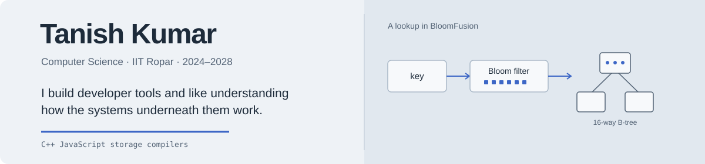
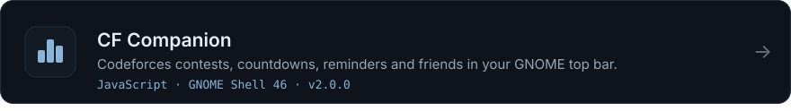
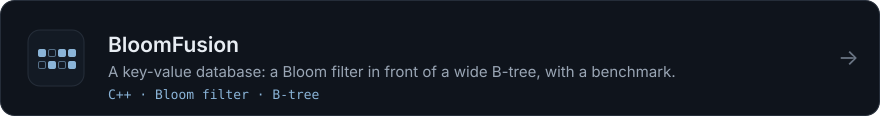
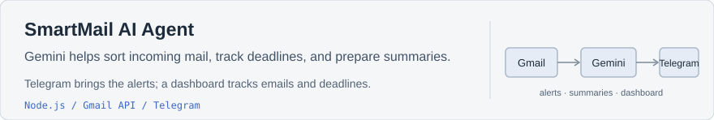
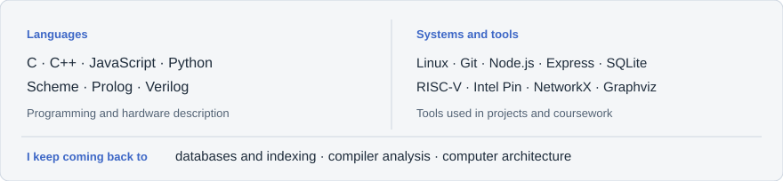
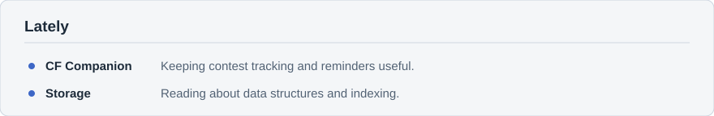

  
  

I build small developer tools and like learning how systems and databases work underneath. I also practise competitive programming on Codeforces as [kumar_Tanish05](https://codeforces.com/profile/kumar_Tanish05).

## Projects

<!-- If the SmartMail repository is public, wrap the next line in a link, like the two cards above:
<a href="https://github.com/Tanishgehlot05/YOUR-REPO-NAME"> ... </a>
Also check that the card text matches the real project (assets/card-smartmail.svg). -->

## Stack

## Now

<!-- Contact: add your email here, or leave it out. -->
