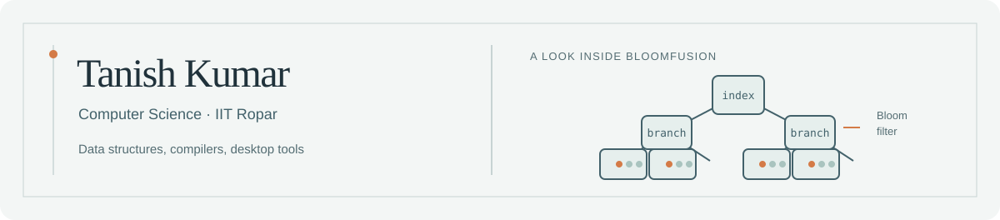
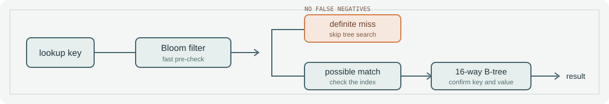

I’m a Computer Science undergrad at IIT Ropar (2024–2028). I like building software I can understand from the inside: data structures, compilers, desktop tools, and the systems beneath them.

Most of my recent work has been in C++ and JavaScript. I also use Python and Verilog, and practise competitive programming as [kumar_Tanish05](https://codeforces.com/profile/kumar_Tanish05).

## Selected work

- [BloomFusion](https://github.com/Tanishgehlot05/BloomFusion) · C++ — A learning key-value database. Its Bloom filter screens misses before a 16-way B-tree lookup; the project includes read and write benchmarks.

- [CF Companion](https://github.com/Tanishgehlot05/cf-companion) · JavaScript — A GNOME Shell extension for Codeforces contests, with top-bar countdowns and desktop reminders. Its optional service adds Telegram notifications and friend standings.
- [SmartMail AI Agent](https://github.com/Tanishgehlot05/SmartMail-AI-Agent) · JavaScript — Gmail notifications and summaries, Gemini-assisted email triage, deadline tracking, Telegram alerts, and a dashboard.

- [Hardwired control unit mini processor](https://github.com/Tanishgehlot05/Hardwired-control-unit-mini-processor) · Verilog — A finite-state-machine control unit for a simplified processor, with a testbench and waveform artifacts.

## Away from projects

Codeforces Specialist, peak rating 1470. More than 500 problems solved across Codeforces, LeetCode, GFG, CSES, AtCoder, and CodeStudio.

## Find me

[LinkedIn](https://www.linkedin.com/in/tanish-kumar05) · [Codeforces](https://codeforces.com/profile/kumar_Tanish05) · [Email](mailto:tanishgehlot5@gmail.com)
