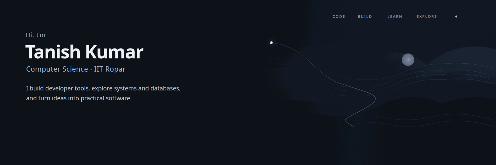

## Tanish Kumar

Computer Science student at IIT Ropar. I build developer tools, study systems and databases, and enjoy competitive programming. I also explore machine learning and computer vision.

**GitHub:** [@Tanishgehlot05](https://github.com/Tanishgehlot05) · [Browse all repositories](https://github.com/Tanishgehlot05?tab=repositories)

## Featured projects

[**cf-companion**](https://github.com/Tanishgehlot05/cf-companion) · **JavaScript**  
A GNOME Shell extension that tracks Codeforces contests with a panel countdown and desktop notifications. An optional backend adds Telegram reminders and friend standings.

---

[**BloomFusion**](https://github.com/Tanishgehlot05/BloomFusion) · **C++**  
A learning project for a key-value database that combines a Bloom filter with a wide B-tree for lookup and storage.

---

[**Hardwired-control-unit-mini-processor**](https://github.com/Tanishgehlot05/Hardwired-control-unit-mini-processor) · **Verilog**  
A simplified processor control unit built around a hardwired finite-state machine, with a testbench and waveform artifacts.

## Technologies and interests

- **Languages:** C++, JavaScript, Verilog.
- **Systems:** GNOME Shell extensions, data structures, processor control logic.
- **Data and exploration:** Bloom filters, B-trees, machine learning and computer vision.

## Current interests

- Developer tooling for competitive programming and contest workflows.
- Storage structures, indexing, and database lookups.
- Digital design and control logic for a small processor.
